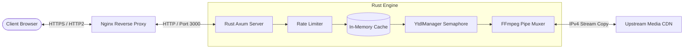

# PipeTube Engine // Zero-Disk Async Media Streaming Service

<p align="center">
  
</p>

<p align="center">
  <strong>Ultra-Lightweight, High-Concurrency Media Stream Extraction & On-the-Fly Muxing Pipeline</strong>
</p>

<p align="center">
  
  
  
  
  
</p>

---

## ⚡ Overview

**PipeTube Engine** is a specialized high-performance media stream extractor and real-time proxy built in **Rust** using the **Axum** asynchronous web framework. 

Designed specifically to operate under tight hardware boundaries (1 vCPU, 512MB–1GB RAM VPS), the engine implements a **Zero-Disk Streaming Architecture**. It extracts, negotiates, and pipes audio/video streams chunk-by-chunk directly from content delivery networks (CDNs) to the client's browser without ever persisting a single byte of media data onto the host's physical hard disk.

---

## 🚀 Key Architectural Highlights

* **Zero-Disk Media Streaming**: Data flows through bounded in-memory channels (64 KB chunk buffers) directly into the HTTP response stream. Zero temporary file writes prevent disk I/O bottlenecks and disk wear.
* **Sub-15MB RAM Footprint**: Native machine code compiled with aggressive Link-Time Optimization (`lto = "fat"`) and dead-code stripping, running at steady-state RSS memory below **15 MB**.
* **On-the-Fly Stream-Copy Muxing**: Employs FFmpeg in stream-copy mode (`-c copy -movflags frag_keyframe+empty_moov+default_base_moof`) to stitch separated adaptive video and audio tracks in real-time with negligible CPU overhead (<10%).
* **Concurrency Semaphore**: Granular process pooling (`tokio::sync::Semaphore`) capping simultaneous background extraction tasks to shield the host VPS from CPU spikes.
* **In-Memory Cache Layer**: Dual-level thread-safe caching (`RwLock`) for video metadata and direct CDN stream tickets, providing instant `0ms` response times for hot queries.
* **Built-in Per-IP Rate Limiting**: Token-bucket sliding window rate limiter safeguarding API endpoints against flood attacks without requiring external Redis instances.
* **Lightweight Multi-Language Frontend**: Responsive dark-mode interface built with Vanilla JavaScript and Tailwind CSS (no heavy frontend framework bloat), featuring automatic Geo-IP language detection across 6 locales (EN, ID, ES, PT, DE, FR).

---

## 🛠️ System Architecture



---

## 📂 Project Structure

```text
├── Cargo.toml                 # Rust dependencies & profile optimizations (LTO, strip)
├── Cargo.lock
├── deploy/
│   ├── nginx.conf             # Production Nginx reverse proxy configuration
│   └── setup.sh               # Automated deployment script for Ubuntu/Debian VPS
├── public/                    # Frontend static assets (Zero-framework)
│   ├── index.html             # Main application portal
│   ├── youtube-to-mp3/        # Dedicated audio extraction route
│   ├── youtube-shorts-downloader/ # Shorts downloader route
│   ├── youtube-to-mp4/        # Video extraction route
│   ├── how-it-works/          # Technical documentation & guide page
│   ├── js/
│   │   └── i18n.js            # 6-Language GeoIP translation engine
│   ├── favicon.svg            # Scalable vector brand asset
│   ├── logo.svg               # Vector brand badge
│   ├── sitemap.xml            # Search Engine sitemap
│   └── robots.txt
└── src/
    ├── main.rs                # Application entrypoint, routing & server initialization
    ├── handlers.rs            # Axum HTTP request handlers & streaming logic
    ├── models.rs              # Strongly-typed Serde data structures
    ├── rate_limiter.rs        # Sliding-window IP rate limiting implementation
    └── ytdl.rs                # yt-dlp execution engine & stream ticket manager
```

---

## 🔧 Tech Stack

| Layer | Component | Description |
| :--- | :--- | :--- |
| **Language** | [Rust 1.75+](https://www.rust-lang.org/) | Memory safety, zero-cost abstractions, zero GC pauses |
| **Framework** | [Axum 0.7](https://github.com/tokio-rs/axum) | Ergonomic, modular async web framework built on Tower |
| **Async Runtime** | [Tokio](https://tokio.rs/) | Multi-threaded async I/O runtime |
| **Streaming Engine** | [FFmpeg 6.1+](https://ffmpeg.org/) | Hardware-efficient stream-copy muxing (`-c copy`) |
| **Web Server** | [Nginx](https://nginx.org/) | Reverse proxy, Gzip compression, edge buffering termination |
| **Frontend** | Vanilla JS + Tailwind CSS | Sub-100KB static payloads, instant browser paint |

---

## 💻 Local Development Setup

### Prerequisites
* Rust toolchain (`cargo`, `rustc` via [rustup.rs](https://rustup.rs/))
* FFmpeg (`sudo apt install ffmpeg`)
* Node.js runtime (for upstream challenge solver)
* yt-dlp binary (`/usr/local/bin/yt-dlp`)

### Quick Start

1. **Clone the repository:**
   ```bash
   git clone https://github.com/ixroo/pipetube-engine.git
   cd pipetube-engine
   ```

2. **Run in development mode:**
   ```bash
   RUST_LOG=ytdl_raw=info,tower_http=info cargo run
   ```

3. **Compile optimized release binary:**
   ```bash
   cargo build --release
   # Binary available at target/release/ytdl-raw
   ```

4. **Verify listening port:**
   The service will start listening on `http://127.0.0.1:3000`. Test the health endpoint:
   ```bash
   curl -I http://127.0.0.1:3000/health
   # Returns: HTTP/1.1 200 OK
   ```

---

## 🔒 Security & Hardening Features

* **SSRF Mitigation**: Canonical URL validation restricting requests strictly to authentic media host domains.
* **Parameter Sanitization**: Format identifiers are rigorously validated against strict alphanumeric patterns to prevent command-line flag injection (e.g., preventing leading hyphens).
* **Linux Sandbox Profile**: Systemd unit configured with `NoNewPrivileges=true`, `ProtectSystem=full`, `ProtectHome=true`, and `PrivateTmp=true`.
* **Bounded Resource Ceiling**: Hard limits enforced via systemd cgroups (`MemoryMax=500M`, `CPUQuota=95%`).

---

## 📄 License & Disclaimer

This software is developed strictly for **educational, architectural research, and portfolio demonstration purposes**. It demonstrates high-throughput asynchronous network programming, zero-disk I/O piping, and stream remuxing in Rust. Ensure compliance with the Terms of Service of any third-party content providers and applicable regional intellectual property laws when running extraction software.
